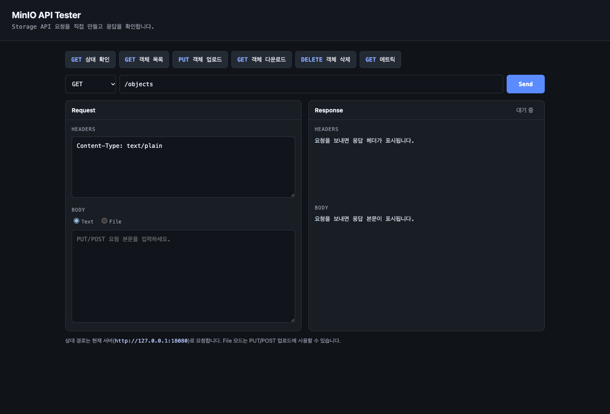

# k8s-minio-kit

Kubernetes에서 MinIO를 S3 호환 스토리지로 실행하고, Go API로 객체를 업로드·조회·삭제하는 예제입니다. Prometheus와 Grafana 모니터링도 포함합니다.



## 실행

요구 사항: Docker, `kind`, `kubectl`

```bash
kind create cluster
docker build -t k8s-minio-kit:dev .
kind load docker-image k8s-minio-kit:dev

kubectl apply -f k8s/minio.yaml
kubectl rollout status deployment/minio
kubectl apply -f k8s/app.yaml -f k8s/monitoring.yaml
kubectl port-forward service/storage 8080:8080
```

브라우저에서 http://localhost:8080 을 열면 API 테스터를 사용할 수 있습니다.

## API

| Method | Path | 설명 |
|---|---|---|
| `GET` | `/healthz` | 상태 확인 |
| `GET` | `/objects` | 객체 목록 |
| `PUT` / `POST` | `/objects/{key}` | 객체 업로드 |
| `GET` | `/objects/{key}` | 객체 다운로드 |
| `DELETE` | `/objects/{key}` | 객체 삭제 |
| `GET` | `/metrics` | Prometheus 메트릭 |

기본 버킷은 `storage`이며, 기본 MinIO 계정은 로컬 실습용 `minioadmin / minioadmin`입니다.
